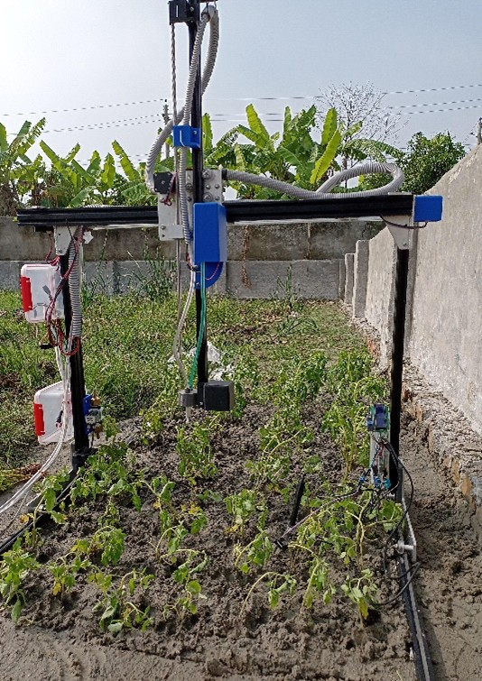
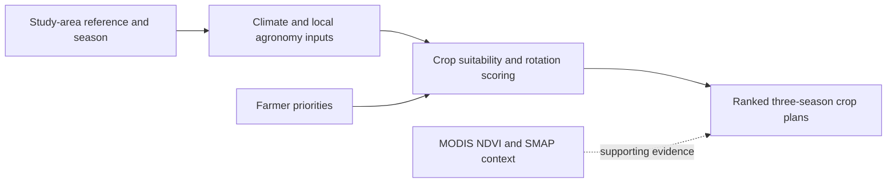
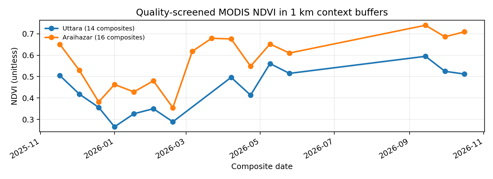
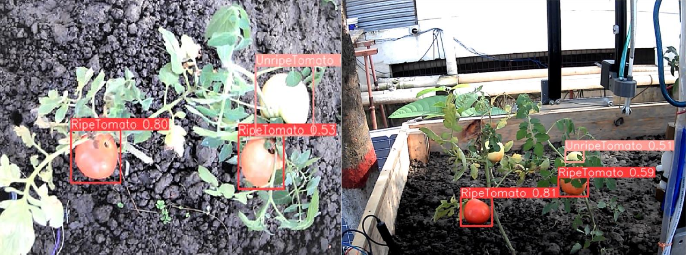
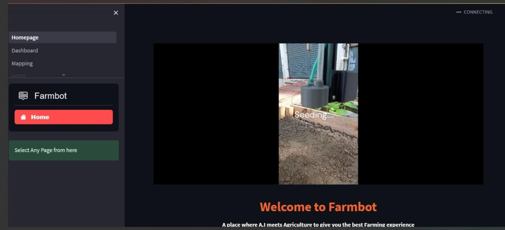

# 🌱 RotaShift — Climate-Aware Crop Rotation Decision Support

**Soil-to-Sky Robo Team · NASA Space Apps Challenge 2026 · Field Shift: Adapting Farms with NASA Data**

> **Plan smarter rotations — from soil to sky.** RotaShift is a Bangladesh-focused decision-support prototype that compares three-season crop rotations using climate information, crop characteristics, soil inputs, irrigation assumptions, agronomic references, and farmer-selected priorities.

<p align="center">
  
</p>

<p align="center">
  <a href="https://www.youtube.com/watch?v=VWTlKhXIzMg">▶ Watch the team's prior Farmbot demonstration</a> ·
  <a href="RotaShift_7_Slide_Demo.pptx">📊 View the seven-slide RotaShift demo</a> ·
  <a href="RotaShift_7_Slide_Demo.pdf">📊 View the seven-slide RotaShift demo</a> ·
  <a href="DATA_AUDIT.md">🧾 Read the data audit</a>
</p>

---

### Soil-to-sky crop-rotation decision support for farms in a changing climate


**🛰️ NASA Space Apps Challenge 2026 · Challenge: _Field Shift: Adapting Farms with NASA Data_**
**👥 Team: Soil-to-Sky Robo Team · 📍 Local Event: Dhaka, Bangladesh**

</div>

---

## 🚜 Project overview

Farmers make crop-rotation decisions under changing temperature, rainfall, water availability, and soil conditions. RotaShift translates selected climate indicators and local agronomic inputs into an explainable comparison of possible crop sequences for Bangladesh's three major growing windows:

- **Rabi** — represented in the prototype as November–February.
- **Kharif-1** — represented as March–June.
- **Kharif-2** — represented as July–October.

The crop catalogue contains **13 crops**: six Rabi crops, four Kharif-1 crops, and three Kharif-2 crops. The current one-crop-per-season design evaluates **72 combinations** (6 × 4 × 3). Users select a study-area reference, provide soil and irrigation assumptions, choose a BARC soil-fertility class, and set the relative importance of water, soil, income, and resilience. A rule-based scoring engine ranks the combinations and exposes the assumptions behind each score.

**Selected challenge:** [Field Shift: Adapting Farms with NASA Data](https://www.spaceappschallenge.org/2026/challenges/field-shift-adapting-farms-with-nasa-data/). The challenge calls for a decision-support tool combining NASA Earth observations with local soil information, crop characteristics, and farmer priorities to explore crop-rotation strategies that can support soil health and adaptation to changing conditions.

## 🎯 Problem and intended impact

A rotation with attractive short-term income may be unsuitable when rainfall, irrigation supply, soil properties, or seasonal temperature are considered. NASA climate and Earth-observation products provide valuable environmental context, while local crop and soil references make that information more relevant to farming decisions.

RotaShift is an **exploratory decision-support prototype**, not an automated farm prescription or yield-prediction model. Its purpose is to make crop and climate assumptions visible, compare alternatives consistently, and provide a starting point for discussion with farmers and agricultural specialists.

## 🧭 How the prototype works

1. **Select a study-area reference.** The current project contains reference points for Uttara Sector 17, Dhaka, and Araihazar, Narayanganj. They are approximate locality coordinates, not surveyed Farmbot plot centres or field boundaries.
2. **Retrieve climate indicators.** The application contains an integration with the NASA POWER daily point API for air temperature (`T2M`), corrected precipitation (`PRECTOTCORR`), and relative humidity (`RH2M`). When the live request is unavailable, the application uses an explicitly labelled synthetic sample fallback.
3. **Set local assumptions.** The user can enter soil pH, seasonal irrigation assumptions, BARC soil-fertility class, climate scenario adjustments, and farmer-priority weights.
4. **Compare crop rotations.** A transparent heuristic considers climate suitability, water fit/efficiency, soil-rotation indicators, a relative income index, and drought/resilience characteristics.
5. **Review supporting evidence.** The interface presents crop-water and fertilizer reference information together with available MODIS NDVI and SMAP context. The supplied satellite summaries are supporting visualisations; they are not inputs to the current rotation-ranking score.
6. **Explore sensitivity.** A Monte Carlo routine perturbs selected assumptions and shows how frequently a plan ranks first. This is a sensitivity exercise under modelled perturbations, not validation against observed yields or field outcomes.

### RotaShift decision-support workflow



The diagram describes the current prototype workflow; the SMAP and MODIS layers are contextual evidence panels and are not inputs to the current rotation-ranking score.

## 🛰️ NASA data and Earth-observation resources

NASA data are central to the project's climate and environmental context. The public Field Shift challenge description calls for NASA Earth observations alongside local soil and crop information and farmer priorities. RotaShift uses the following NASA sources and documents the role and limits of each one.

| NASA source | Data included or implemented | Role in RotaShift | Interpretation |
|---|---|---|---|
| [NASA POWER Daily Point API](https://power.larc.nasa.gov/api/temporal/daily/point) | API integration in `src/nasa_power.py`; variables `T2M`, `PRECTOTCORR`, and `RH2M` | Supplies daily climate indicators to the climate component of rotation scoring when the live request succeeds | No cached live POWER response is included. When the API is unavailable, the application displays a warning and uses clearly labelled synthetic sample climate data. |
| [NASA SMAP SPL3SMP_E V006](https://developers.google.com/earth-engine/datasets/catalog/NASA_SMAP_SPL3SMP_E_006) | Two raw Google Earth Engine exports, one per study-area reference; processed table at `data/smap_all.csv` | Provides regional soil-moisture context and demonstrates satellite QA handling | All 450 processed site-date records in the 9 km processing radius have retrieval flag 1, which the Earth Engine catalogue identifies as unacceptable quality. The wider raw export contains a flag-0 Uttara pixel about 15.12 km from the reference point; no flag-0 pixel was found in the Araihazar 18 km export. SMAP is not field-scale ground truth and is not used in the current rotation score. |
| [NASA Terra MODIS MOD13Q1 V6.1](https://developers.google.com/earth-engine/datasets/catalog/MODIS_061_MOD13Q1) | Two raw exports containing NDVI, EVI, DetailedQA, and SummaryQA; processed table at `data/ndvi_all.csv` | Provides regional vegetation-condition context | The raw exports contain 22 composites for each reference area. The supplied processing retains 14 Uttara and 16 Araihazar site-date composites. The resulting summaries represent a 1 km context buffer around approximate coordinates, not a mapped farm field. MODIS NDVI is not used in the current rotation score. |
| [NASA Harmonized Landsat Sentinel-2 (HLS) V002](https://developers.google.com/earth-engine/datasets/catalog/NASA_HLS_HLSS30_v002) | Earth Engine export logic is included under `tools/gee/` | Represents a finer-resolution vegetation-monitoring pathway | HLS export code is present, but no HLS result CSV is included in this repository. HLS integration is therefore not reported as completed. |

### 🧪 Satellite data quality summary

The supplied raw files are Google Earth Engine exports associated with the two approximate locality-reference points. They preserve the source values and quality bands for downstream interpretation.

<p align="center">
  
</p>

- **SMAP:** The processed 9 km table contains 450 site-date rows, all with retrieval flag 1 and `flagged_not_recommended` status. In the wider 18 km raw export, an acceptable flag-0 pixel appears for Uttara at approximately 15.12 km from the reference point; no acceptable flag-0 pixel appears in the corresponding Araihazar export. The dataset is therefore retained as a quality-limited regional context layer, not as evidence of plot soil moisture.
- **MODIS NDVI:** The processed table contains 30 site-date records: 14 for Uttara and 16 for Araihazar. The mean NDVI in the supplied processed data is approximately 0.437 for Uttara and 0.575 for Araihazar. These values describe the satellite pixels selected by the supplied extraction and quality-screening workflow; they do not establish the condition or identity of a specific crop in a field.
- **HLS:** The repository contains export logic, not downloaded HLS observations.

The SMAP retrieval-quality interpretation follows the Earth Engine product catalogue: retrieval flag `0` denotes acceptable quality and flag `1` denotes unacceptable quality. MODIS NDVI uses the product's scale factor and QA information in the processing workflow. Raw QA bands are retained in the source exports.

## 🌾 Crop catalogue and agronomic references

The crop catalogue has 13 entries across three season windows:

| Season | Crops |
|---|---|
| **Rabi** | Boro rice, wheat, mustard, lentil, potato, tomato |
| **Kharif-1** | Maize, mungbean, jute, Aus rice |
| **Kharif-2** | Aman rice, soybean, sesame |

### Fertilizer information

`data/barc_frg.csv` contains 52 crop/fertility-class records covering 13 crops and four soil-fertility classes. The reference materials are included under `data/references/`, including the BARC Fertilizer Recommendation Guide-2024 workbook and extracted CSV files.

The current app dataset represents one yield/variety group for each rice crop: high-yield Boro (7.5 ± 0.75 t/ha), Aus (4.0 ± 0.4 t/ha), and Aman (6.0 ± 0.6 t/ha). BARC FRG-2024 contains additional rice yield/variety groups that are not represented in the current app data. Nutrient rates are expressed as kilograms of nutrient per hectare, not weights of commercial fertilizer products. The values are reference ranges and do not replace field soil testing or local extension advice.

### Crop-water information

- **Nine crops:** ETc and/or net-irrigation reference values are drawn from BRRI Annual Report 2017–2018 CROPWAT tables. They are modelled regional averages from other Bangladesh locations, not measurements at the two RotaShift study-area references.
- **Tomato, mungbean, soybean, and sesame:** coefficient-based FAO-56 planning estimates are included with ranges and documented assumptions. They are estimates, not locally measured crop evapotranspiration.
- **ETc and net irrigation are different quantities.** Net irrigation can include effects such as effective rainfall and land-preparation requirements; it must not be interpreted as crop evapotranspiration.

The crop and water records are in `data/crops.csv`, `data/fao56_planning_estimates.csv`, and `data/references/RotaShift_BRRI_water_reference.csv`.

## 🤖 Farmbot and computer-vision research

Soil-to-Sky Robo Team's gantry-style agricultural Farmbot, outdoor sensor network, and YOLOv8 tomato-ripeness work are pre-existing research assets. They provide the robotics context for the team's interest in agricultural monitoring and a possible future path for collecting field observations.

The supplied computer-vision image demonstrates ripe/unripe tomato detection. It does **not** demonstrate crop-disease diagnosis. The YouTube link is a prior Farmbot thesis demonstration, not a recording of the RotaShift crop-rotation application:

<p align="center">
  
</p>

▶ [Watch the team's Farmbot demonstration](https://www.youtube.com/watch?v=VWTlKhXIzMg)

### Earlier Farmbot Streamlit interface

<p align="center">
  
  
</p>

*This is a screenshot of the team's earlier Farmbot Streamlit interface. Its visible navigation and labels are in English. It documents the team's prior Farmbot software work; it is not presented as the current RotaShift crop-rotation dashboard.*

The repository includes the team's original outdoor Farmbot photograph (`assets/Picture1.jpg`), earlier Farmbot interface screenshot (`assets/streamlit.jpg`), tomato ripe/unripe detection results (`assets/Tomato_detection_1.png`), and the processed MODIS NDVI chart (`assets/modis_ndvi_actual_processed.png`). The Farmbot and earlier YOLOv8 work are identified as prior work rather than newly developed RotaShift components.

## 📊 Project implementation status

| Component | Status represented by the repository |
|---|---|
| Streamlit interface and rotation scoring | Source code included; the application can be launched with the listed Python dependencies. |
| NASA POWER | Live API integration implemented. No cached live API response is included. Synthetic fallback climate data are visibly labelled in the application. |
| SMAP | Actual raw Earth Engine exports included. The processed 9 km observations are all not-recommended quality for the supplied reference points. |
| MODIS NDVI | Actual raw Earth Engine exports and processed quality-screened site-date records included. |
| HLS 30 m | Export code included; no HLS result CSV is included. |
| Farmbot sensor measurements | A CSV schema and labelled synthetic example log are included. No real Farmbot sensor export is included. |
| Soil-moisture calibration | A calibration workflow and labelled simulated examples are included. No real paired sensor/oven-dry reference measurements or validated calibration result are included. |
| BARC fertilizer data | 13 crops × four fertility classes are represented. Additional rice yield/variety groups in FRG-2024 are not in the current app table. |
| Disease information | The 14 rules in `data/diseases.csv` are unverified and hidden by default. They are not diagnostic thresholds. |
| Field validation | No real sensor-to-satellite validation metrics or observed-yield validation results are included. |

Files with `SYNTHETIC`, `SIMULATED`, or `PROXY` in their names are generated examples for software demonstration and testing. They are not real Farmbot readings, calibration measurements, or NASA satellite observations.

## 🖥️ Run the application

### Requirements

- Python 3.10 or newer
- Internet access for live NASA POWER requests
- A terminal or command prompt

### Install and launch

Download the repository ZIP from GitHub and extract it. Open a terminal in the extracted repository folder (the folder containing `app.py`) and run:

```bash
python -m venv .venv
```

Activate the environment:

```powershell
# Windows PowerShell
.venv\Scripts\Activate.ps1
```

```bash
# macOS / Linux
source .venv/bin/activate
```

Install dependencies and launch Streamlit:

```bash
pip install -r requirements.txt
streamlit run app.py
```

The application opens in a browser. If NASA POWER cannot be reached, the application displays a warning and uses synthetic sample climate data. Rankings generated from that fallback are demonstration outputs, not results based on a live NASA POWER response.

## 🔄 Rebuild the processed satellite tables

The supplied raw Earth Engine files are stored in `data/raw_ee_exports/`. From the repository root, the processed tables can be rebuilt with:

```bash
python tools/prepare_ee_raw.py \
  --smap data/raw_ee_exports/RotaShift_SMAP_RAW_Uttara.csv data/raw_ee_exports/RotaShift_SMAP_RAW_Araihazar.csv \
  --ndvi data/raw_ee_exports/RotaShift_MODIS_RAW_Uttara.csv data/raw_ee_exports/RotaShift_MODIS_RAW_Araihazar.csv \
  --smap-quality flagged \
  --max-dist-km 9 \
  --max-summary-qa 1
```

The supplied raw files reproduce `data/smap_all.csv` (450 SMAP site-date rows) and `data/ndvi_all.csv` (30 MODIS site-date rows) with the repository's processing workflow. Earth Engine scripts are in `tools/gee/`.

## 🗂️ Repository structure

```text
RotaShift/
├── app.py                         # Streamlit application
├── README.md                      # Project overview and reproducibility notes
├── requirements.txt               # Python dependencies
├── AI_DISCLOSURE.md               # AI/SI use disclosure
├── LICENSE_STATUS.md              # Current licence status
├── CITATION.cff                   # Citation metadata
├── src/                           # Agronomy, scoring, NASA POWER, metrics
├── tools/                         # Data processing, ingestion, calibration
│   └── gee/                       # Google Earth Engine JavaScript exports
├── data/
│   ├── raw_ee_exports/             # Actual raw SMAP and MODIS exports
│   ├── references/                 # BARC and BRRI reference files
│   ├── demo_synthetic/             # Clearly labelled synthetic examples
│   ├── diagnostics/                # Point-level quality diagnostics
│   └── *.csv                       # Crop, site, sensor schema, processed tables
├── assets/                         # Team-supplied Farmbot, tomato-detection, and satellite visuals
├── docs/                           # Data audit, status, sources, submission notes
├── presentation/                   # Seven-slide project demo and speaker notes
└── tests/                           # Project data integrity tests
```

## 👥 Team

- **Team:** Soil-to-Sky Robo Team
- **Local Event:** Dhaka, Bangladesh
- **Team lead:** MD Zonayed
- **Team size:** Six participants, as described by the team

The project documentation focuses on the team's collective work and the technical contributions represented in the supplied project archive.

## 🧠 Super Intelligence (SI) / AI disclosure

AI tools assisted with parts of the starter code, calibration-script drafting, a team logo, code and data review, interpretation of uploaded exports, documentation, submission text, and presentation preparation. The original project archive records assistance from Anthropic Claude; OpenAI ChatGPT assisted with subsequent code review, data interpretation, repository documentation, submission drafting, and presentation materials. The project concept, prior Farmbot assets, source archives, and final project decisions were supplied by the team. AI-assisted code and text remain subject to ordinary technical review and testing.

The repository's presentation uses team-supplied photographs and screenshots. No NASA logo, flag, mission identifier, or other NASA branding has been generated or modified by AI. Any AI-generated team graphic is identified as AI-generated where used.

## 📚 Data sources and references

### NASA and satellite products

1. [NASA Space Apps 2026 — Field Shift challenge](https://www.spaceappschallenge.org/2026/challenges/field-shift-adapting-farms-with-nasa-data/)
2. [NASA POWER Daily Point API](https://power.larc.nasa.gov/api/temporal/daily/point)
3. [NASA SMAP SPL3SMP_E V006 — Earth Engine catalogue](https://developers.google.com/earth-engine/datasets/catalog/NASA_SMAP_SPL3SMP_E_006)
4. [NASA Terra MODIS MOD13Q1 V6.1 — Earth Engine catalogue](https://developers.google.com/earth-engine/datasets/catalog/MODIS_061_MOD13Q1)
5. [NASA HLS V002 — Earth Engine catalogue](https://developers.google.com/earth-engine/datasets/catalog/NASA_HLS_HLSS30_v002) (export code is included; result data are not included)

### Bangladesh agronomy and crop-water references

6. Hossain, M. B., et al. (2024). *Fertilizer Recommendation Guide-2024*. Bangladesh Agricultural Research Council (BARC), Dhaka. [Official guide](https://apps.barc.gov.bd/fertilizer_recommendation/FRG%20English%2030.10.2024.pdf)
7. Bangladesh Rice Research Institute (2018). *Annual Report 2017–2018*, Irrigation and Water Management Division, CROPWAT Tables 5–6, pp. 96–97. [BRRI report](https://objectstorage.ap-dcc-gazipur-1.oraclecloud15.com/n/axvjbnqprylg/b/V2Ministry/o/office-brri/2024/12/5ab3dc06b8414cea98ec83d291f6da60.pdf)
8. Allen, R. G., et al. (1998). *Crop Evapotranspiration: Guidelines for Computing Crop Water Requirements*. FAO Irrigation and Drainage Paper 56.
9. USDA-SCS effective-rainfall method as implemented in `src/scoring.py`.

### Prior robotics and software resources

10. Soil-to-Sky Robo Team's pre-existing Farmbot prototype, sensor-network work, and YOLOv8 tomato-ripeness demonstration; team video: https://www.youtube.com/watch?v=VWTlKhXIzMg.
11. Team-supplied photographs and application/simulation screenshots in `assets/`.
12. Roboflow-hosted datasets are referenced in the original history of prior model development. The source archive does not provide a complete dataset URL/licence manifest, and those third-party datasets are not redistributed in this repository.
13. Python, Streamlit, pandas, NumPy, Requests, and Google Earth Engine are used in the project code; dependencies are listed in `requirements.txt`.

## ⚖️ Licence and project disclaimer

No blanket open-source licence is applied to this repository. The source archive describes an adapted Streamlit helper component but does not contain its upstream project URL or licence. The repository therefore does not grant a blanket reuse licence for all code, media, or third-party materials. Individual NASA, BARC, BRRI, FAO, software, and media sources remain subject to their respective terms.

RotaShift is an independent NASA Space Apps Challenge project. It is not an official NASA product, and NASA does not endorse the application or its outputs. Rotation rankings are exploratory decision-support results based on the selected inputs and heuristic scoring rules. They are not guaranteed yield outcomes, agronomic prescriptions, or substitutes for field soil tests and advice from local agricultural specialists.
